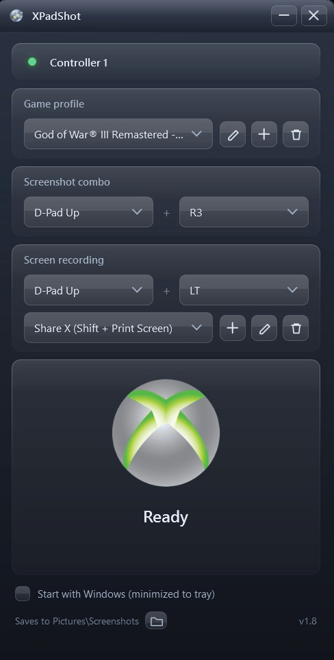

# XPadShot

Controller-combo screenshots for Windows. A small dark-glass WPF tool (Vista-era
Aero styling, obsidian variant) that lives in your notification tray: press a
combo on your XInput pad - e.g. **LB + A** - and the whole desktop is saved as a
PNG.



## What it does

- **First run asks for your shortcut** - the welcome dialog lets you pick the
  combo that saves a screenshot; you can change it any time later.
- **Start with Windows (minimized to tray)** - toggle at the bottom of the
  window. Adds a per-user Run entry running `XPadShot.exe --minimized`, so
  after login the app sits in the tray with your combos already live.
- **Named profiles.** Profiles are free-form: create, name, and rename them.
  They are not bound to any process - switch between them with the picker
  (each profile keeps its own combo). New profiles are named after the app that
  was last in focus (the app detects the foreground process automatically - you
  never pick one), are renameable with the pencil button, and start from the
  currently selected combo.
- Hold both combo buttons - one screenshot, once per press. The second button
  can be "None" for single-button combos.
- **Screen recording combo.** Each profile has a second controller combo that
  synthesizes a keyboard shortcut. The dropdown offers the built-in **Game Bar
  record** hotkey (**Win + Alt + R**) plus a library of *named custom
  shortcuts*: add one with the **+** button and pick the modifiers (Ctrl / Alt
  / Shift / Win) and the key from dropdowns (letters, digits, F-keys, numpad,
  arrows, Print Screen and more) - the combo then sends exactly that chord, so
  point it at whatever your recording tool listens for (e.g. a ShareX hotkey). The pencil renames a shortcut or changes its keys; the trash
  button deletes it (profiles using it fall back to the Game Bar hotkey).
  Verified on this machine: injected Win-combos do reach the Game Bar; clips
  land in `Videos\Captures`.
- **Works while a game has focus** - no focus switching, no input injected into
  games (XInput is read-only; the keyboard shortcut is a system-level hotkey).
- **A synthesized shutter click** plays on every capture (no sound asset file;
  the WAV is generated in memory). Preview it with `XPadShot.exe --test-sound`.
- **Feedback toast.** A small semi-transparent red box slides in from the
  right screen edge to the top right corner and slides back out to the right
  when it dismisses: "Screenshot taken" on every capture, and "Recording
  started" / "Recording ended" as the recording combo is pressed (the hotkey
  is a toggle, so the message alternates). The toast is click-through, never
  steals focus, and sits above normal and borderless-fullscreen windows.
- Saves to `%USERPROFILE%\Pictures\Screenshots`.
- **File names**: `<app or page> - dd-MM-yyyy HH-mm-ss.png` - for example
  `Lofi Girl - YouTube - 16-10-2026 21-03-45.png`. The label comes from the
  foreground window title (browser suffixes like " - Brave" are stripped);
  the process name is the fallback, `Screenshot` the last resort.
- Covers all monitors combined, exactly like Win+PrtScn.

## Tray behaviour

- Closing the window (the X button) does **not** quit: the app keeps running in the
  notification tray so your combo stays live. A balloon tells you so the first
  time.
- **Double-click** the tray icon to bring the window back.
- **Right-click, then Exit** to actually quit.
- Launching `XPadShot.exe` again just brings the existing instance forward.

## Why not simulate Win+PrtScn?

That was the first approach and it was tested on Windows 11: the OS shell
**ignores SendInput-injected keystrokes for the Win+PrtScn hotkey** (verified -
injected input arrives fine, the shell just doesn't act on it). So the app
captures the desktop directly with the same result - no dependency on the
hotkey or on which window has focus.

## Running

```powershell
dotnet run                          # dev run
dotnet build -c Release             # builds bin\Release\net8.0-windows\XPadShot.exe
dotnet publish -c Release -o publish
XPadShot.exe --capture              # headless: capture once and exit
XPadShot.exe --test-sound           # play the shutter sound
XPadShot.exe --minimized            # start straight to the tray (used by the Windows-startup option)
```

- Requires the .NET 8 Desktop Runtime (already present on this machine).

## Notes & limits

- **Borderless / windowed games and the desktop**: capture works normally.
- **True exclusive-fullscreen titles**: may capture a black frame - that's a
  limitation of desktop-compositor capture, so prefer borderless mode in games.
  The feedback toast has the same rule: it draws over the desktop and
  borderless-fullscreen apps, but no normal window (without injecting into the
  game) can appear over true exclusive fullscreen.
- LT/RT count as pressed past ~25% of their travel.
- Settings live in `%APPDATA%\XPadShot\settings.json` (profiles, combos, the
  custom-shortcut library, the selected profile). Older settings formats
  migrate automatically.
- Hot-plug friendly: it polls all four XInput slots and follows the first
  connected pad.
- Crash safety: unexpected UI errors are logged to
  `%TEMP%\XPadShot.error.log` and shown in a dialog instead of killing the
  background app.

## Layout

| Path | Role |
| --- | --- |
| `assets/` | App icon (`Xpadshot.png` + generated `xpadshot.ico`) and the shutter button art (`Button_Logo.png`) |
| `App.xaml(.cs)` | Composition root, tray icon, single-instance, first-run, `--capture` / `--test-sound` |
| `MainWindow.xaml(.cs)` | The whole UI + glow/flash animations |
| `Views/FirstRunDialog.xaml(.cs)` | Welcome / shortcut setup on first launch |
| `Views/ShortcutDialog.xaml(.cs)` | Add/edit dialog for custom recording shortcuts (name + modifier/key pickers) |
| `Views/ConfirmDialog.xaml(.cs)` | Small glass confirm prompt (shortcut deletion) |
| `Views/OverlayToast.xaml(.cs)` | The red feedback toast (top right corner, animated, click-through, topmost) |
| `Theme/Glass.xaml` | Palette, glass cards, gel buttons, combo/list/textbox styling |
| `ViewModels/MainViewModel.cs` | Profile state, capture flow, persistence |
| `ViewModels/ProfileItem.cs` | Editable profile (name, combo) |
| `Services/ControllerWatcher.cs` | 125 Hz XInput poller, edge-triggered combos (screenshot + recording) |
| `Services/KeyboardSender.cs` | Synthesizes the recording keyboard shortcuts (SendInput) |
| `Services/OverlayService.cs` | Lazily manages the shared feedback-toast window |
| `Services/ForegroundWatcher.cs` | Foreground app tracking (file labels, new-profile names) |
| `Services/ScreenshotService.cs` | Desktop capture + file naming |
| `Services/SoundService.cs` | Synthesized shutter click |
| `Services/SettingsService.cs` | Profile persistence + migration |
| `Services/StartupService.cs` | The "start with Windows" Run entry |
| `Services/TrayIconFactory.cs` | Tray icon from the app logo |
| `Interop/XInput.cs` | xinput1_4 -> 1_3 -> 9_1_0 fallback chain |
